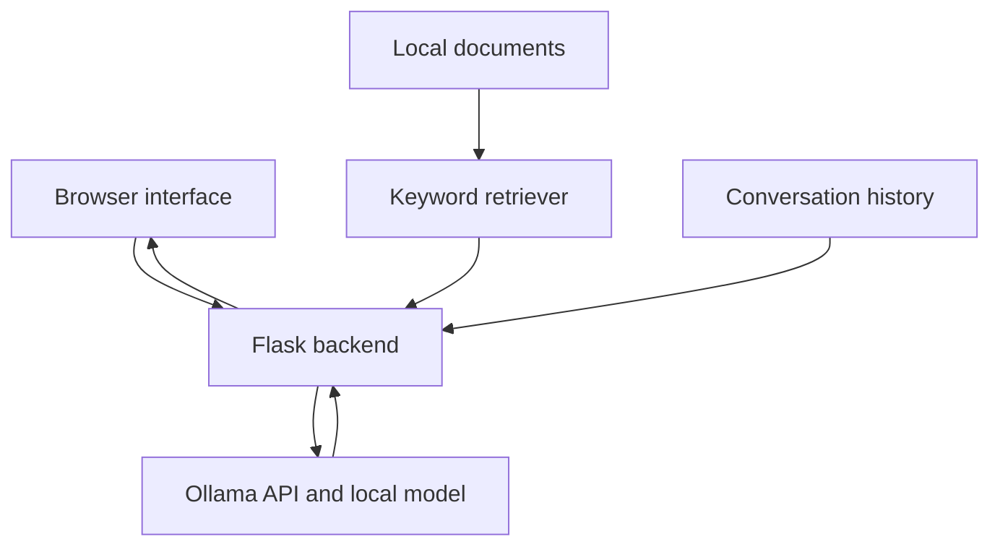

# Mini-RAG: Local AI with Ollama

A local course assistant built with Python, Flask, and Ollama. It combines a locally running language model with document retrieval, conversation history, and structured JSON responses.

**Author:** Loubna El Ghazi

## Overview

This project explores how to build an AI application without relying on a cloud inference API.

Ollama runs the language model locally, while a Python backend retrieves relevant course content and includes it in the model’s input. A Flask interface displays answers, retrieved sources, and performance measurements.

The accompanying laboratory experiments cover prompt design, code generation, model comparison, document grounding, and optional image analysis.

## Features

- **Local inference:** Generate responses through a locally running Ollama server.
- **Flask interface:** Ask questions through a browser.
- **Conversation history:** Include the last six user/assistant pairs in subsequent requests.
- **Document-based answers:** Retrieve relevant information from local course files.
- **Mini-RAG:** Use keyword retrieval with TF-IDF-style weighting.
- **Structured output:** Request JSON responses using a predefined schema.
- **Source visibility:** Display retrieved document names and relevance scores.
- **Performance measurements:** Record response time, token counts, and generation speed.
- **Conversation reset:** Clear the application’s stored history.

Additional notebook experiments demonstrate code assistance and image understanding with a compatible multimodal model.

## Tech Stack

| Technology | Purpose |
|---|---|
| Python | Application logic and experiments |
| Ollama | Local model management and inference |
| Qwen3.5:4b / Gemma3:4b | Models used in the comparison |
| Flask | Web application and HTTP endpoints |
| requests | Communication with Ollama |
| Keyword retrieval | Document ranking with TF-IDF-style weights |
| HTML, CSS, JavaScript | Browser interface |
| pandas / Matplotlib | Benchmark analysis and charts |
| psutil | System RAM measurements |

## How It Works

1. The user submits a question through the browser.
2. Flask searches the local documents and selects the two highest-ranked relevant results.
3. The backend combines the retrieved context, system instructions, and recent conversation history.
4. Ollama runs the selected local model.
5. Flask returns the answer, sources, response time, and available generation metrics.



The retriever does not use a vector database. It ranks documents using overlapping terms and inverse-document-frequency weights.

The model is instructed to answer from the supplied context and return **“Information not available.”** when the answer is absent.

## Project Structure

| Path | Description |
|---|---|
| `LocalAI_Lab/source/app.py` | Flask assistant with RAG and conversation history |
| `LocalAI_Lab/source/chatbot.py` | Console chatbot |
| `LocalAI_Lab/source/rag.py` | Document loading, retrieval, and prompt construction |
| `LocalAI_Lab/source/benchmark.py` | Model performance benchmark |
| `LocalAI_Lab/source/templates/index.html` | Web interface |
| `LocalAI_Lab/documents/` | Local course materials |
| `LocalAI_Lab/screenshots/` | Screenshots documenting the experiments |
| `LocalAI_Lab/report.pdf` | Laboratory report |
| `LocalAI_Lab/README.md` | Project documentation |

The document collection includes:

- `ai.txt`
- `course.txt`
- `deep_learning.txt`
- `machine_learning.txt`
- `reinforcement_learning.txt`

## Getting Started

### 1. Prerequisites

- Python 3.10 or newer
- Ollama
- pip
- Enough RAM, storage, and optionally VRAM for the selected model

A dedicated GPU can improve performance but is not required. Memory requirements depend on the model, quantization, and context length.

### 2. Install and Start Ollama

Download Ollama from [ollama.com/download](https://ollama.com/download).

For Linux:

```bash
curl -fsSL https://ollama.com/install.sh | sh
```

Verify installation:

```bash
ollama --version
```

If the service is not already running:

```bash
ollama serve
```

Keep Ollama running while using the application.

### 3. Download the Tested Models

```bash
ollama pull qwen3.5:4b
ollama pull gemma3:4b
```

Check available models:

```bash
ollama list
```

The model names must match the installed tags exactly.

### 4. Install Python Dependencies

From the folder containing `LocalAI_Lab`:

```bash
cd LocalAI_Lab
python -m venv .venv
```

Activate the environment on Linux/macOS:

```bash
source .venv/bin/activate
```

On Windows PowerShell:

```powershell
.\.venv\Scripts\Activate.ps1
```

Install dependencies:

```bash
python -m pip install flask requests pandas matplotlib psutil
```

### 5. Run the Web Application

From `LocalAI_Lab`:

```bash
cd source
```

Set the model on Linux/macOS:

```bash
export MODEL="qwen3.5:4b"
python app.py
```

On Windows PowerShell:

```powershell
$env:MODEL = "qwen3.5:4b"
python app.py
```

Open:

**http://127.0.0.1:5001**

To use Gemma instead, set `MODEL` to `gemma3:4b` and restart the application.

Stop the server with `Ctrl+C`.

### Configuration

| Variable | Purpose | Application default |
|---|---|---|
| `MODEL` | Exact installed model name | `qwen3.5` |
| `OLLAMA_URL` | Ollama server address | `http://localhost:11434` |
| `PORT` | Flask application port | `5001` |

Set `MODEL=qwen3.5:4b` explicitly to reproduce the tested configuration.

## Example Questions

- What is reinforcement learning?
- And how is it different from supervised learning?
- Summarize deep learning.
- What is quantum computing?

The last question is outside the supplied course content and should produce **“Information not available.”**

Enable the interface’s structured-output option to request a JSON response containing:

- `topic`
- `summary`
- `key_points`
- `difficulty`

## Additional Experiments

### Console Chatbot

From `LocalAI_Lab/source`:

```bash
python chatbot.py
```

The supplied console script uses `qwen3.5:4b`. Edit its `MODEL` constant if using another installed model.

Type `exit` to stop.

### Model Benchmark

From `LocalAI_Lab/source`:

```bash
python benchmark.py qwen3.5:4b gemma3:4b
```

The benchmark uses the prompt:

> Write a 500-word explanation of reinforcement learning.

It requests model unloading before each run and records:

- Model disk size
- Loaded size and VRAM allocation
- Model load time
- Total request time
- Generated tokens
- Generation throughput
- System RAM usage

**Answer quality is rated manually.** The benchmark script does not automatically assess correctness or retain answer text in its original implementation.

### Recorded Results

Latest recorded Part 16 run:

| Metric | Qwen3.5:4b | Gemma3:4b |
|---|---:|---:|
| Disk size (GB) | 3.32 | 3.35 |
| Loaded size (GB) | 3.14 | 2.88 |
| VRAM (GB) | 3.14 | 2.88 |
| Load time (s) | 35.11 | 7.97 |
| Response time (s) | 47.25 | 20.03 |
| Generated tokens | 731 | 800 |
| Generation speed (tokens/s) | 61.39 | 67.56 |
| System RAM used (%) | 48.2 | 58.8 |

These are single-run measurements on the laboratory machine. System RAM percentages include other processes and do not represent isolated model memory usage.

In the programming exercise, both generated primality functions matched a reference implementation for all 2,005 integers from −5 to 1,999.

## Limitations

- Keyword retrieval may miss synonyms or ambiguous follow-up questions.
- Conversation history is stored in process memory for a **single-user demonstration**.
- The backend sends the last six conversation pairs, but the stored history list grows until reset or restart.
- Restarting the application clears conversation history.
- RAG reduces unsupported answers but does not eliminate hallucinations.
- Valid JSON does not guarantee factually correct content.
- Performance depends on hardware, model settings, context length, and other running processes.
- Optional vision experiments belong to the notebook and are not part of the final web interface.

## Security

The Flask application binds to `127.0.0.1` with debugging disabled.

Keep Ollama and the application local unless remote access is required. For remote deployment, use authentication, TLS, firewall restrictions, and separate conversation state for each user.

Retrieved documents should be treated as untrusted input because they may contain prompt-injection instructions.

## Conclusion

This project demonstrates how to combine Ollama, Flask, local document retrieval, conversation history, and structured output into a practical course assistant.

The experiments show that model selection should consider measured latency, memory requirements, and verified answer quality. Reliable application behavior also depends on retrieval, validation, and careful management of conversation state.

## Purpose

Created by **Loubna El Ghazi** for educational and experimental purposes.
